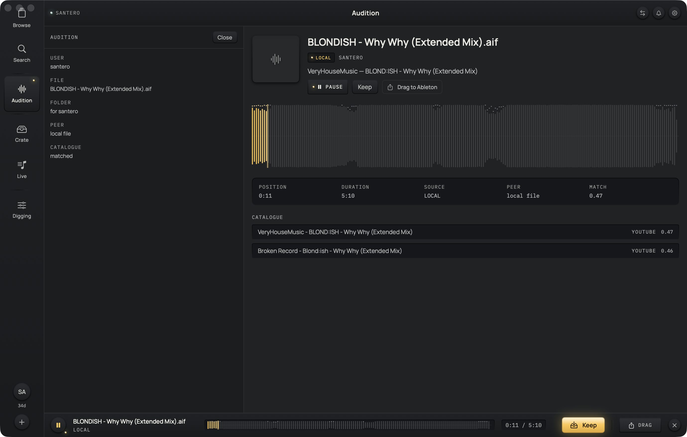

# Handoff — Nicotine+ fork with digging workflow

Last updated: 2026-11-25 · branch `main-ours` · 45 commits ahead of `origin/master`

This is a working fork of [Nicotine+](https://github.com/nicotine-plus/nicotine-plus)
(Python 3.11+, GTK 4 via PyGObject, GPL-3.0-or-later) extended into a
crate-digging tool for sampling: browse Soulseek shares, audition tracks,
keep them, separate stems and land them in Ableton Live.

The long-term direction is a **native SwiftUI client** talking to this Python
engine over a local API. The engine boundary already exists; see
[ENGINE-API.md](ENGINE-API.md). The client's look and structure are specified in
[UI-DIRECTION.md](UI-DIRECTION.md): arcaNative's design system
(`/Users/santero-tribe/Schema Apps/arcaNative`) on the reference's three-column
skeleton.

---

## 1. Environment

| | |
|---|---|
| Repo | `/Volumes/Schema Era/Schema Apps/nicotine` |
| Branch | `main-ours` (upstream `origin` = nicotine-plus) |
| Python | 3.14.7 in `.venv` (**created with `--system-site-packages`** so `gi` resolves) |
| GUI stack | GTK 4.24.2, libadwaita 1.10, gspell 1.14 (Homebrew) |
| Python deps | PyGObject 3.58, PyObjC 13.1, sounddevice 0.5.6, yt-dlp, pytest, pylint |
| Media | `ffmpeg`/`ffprobe` (Homebrew), `afplay` (fallback only) |
| macOS toolchain | `swiftc` (Xcode CLT) — used to build the drag helper |

Run the app (always with the isolated dev profile):

```sh
cd "/Volumes/Schema Era/Schema Apps/nicotine"
GTK_A11Y=none .venv/bin/python -m pynicotine --config "$PWD/.dev/config" --user-data "$PWD/.dev/data"
```

Run with the engine API (needed for native-client work):

```sh
NICOTINE_API_PORT=8766 NICOTINE_API_TOKEN=devtoken GTK_A11Y=none \
  .venv/bin/python -m pynicotine --config "$PWD/.dev/config" --user-data "$PWD/.dev/data"
```

Headless engine (for a native front end):

```sh
NICOTINE_API_PORT=8766 NICOTINE_API_TOKEN=devtoken \
  .venv/bin/python -m pynicotine -n --config "$PWD/.dev/config" --user-data "$PWD/.dev/data"
```

Tests and lint:

```sh
XDG_CONFIG_HOME=/tmp/digcfg .venv/bin/python -m pytest pynicotine/tests -q   # 165 passed, 1 skipped
.venv/bin/python -m pylint --rcfile=pyproject.toml pynicotine/digging pynicotine/gtkgui/digplayer.py
```

### Profile layout (isolated dev profile — do not commit credentials)

```
.dev/config            the Nicotine+ config FILE (not a directory); contains the account
.dev/digging.json      digging settings (renderer, tokens, export dir, cache budget)
.dev/data/digging/     crate.json, downloads/, previews/, exports/, stems/, sessions/, bin/
```

`.dev/config` holds the Soulseek password in plain text — never print or copy it.

---

## 2. What was built (module map)

### Engine side — `pynicotine/digging/`

| Module | Responsibility |
|---|---|
| `analyze.py` | ffprobe metadata, onset-autocorrelation tempo detection, waveform peaks |
| `audition/match.py` | filename parsing, iTunes + YouTube search, duration-weighted scoring |
| `audition/player.py` | PortAudio playback, buffered streams, crossfade `adopt()`, seek guards |
| `audition/buffer.py` | growing PCM buffer + ffmpeg stream decoder |
| `audition/peer.py` | peer preview transfer lifecycle, partial-file handoff, keep promotion |
| `pipeline.py` | one track → stems: renderer + Live Set |
| `renderers/` | MVSEP cloud, studio-PC agent, local Demucs |
| `agent.py` | standalone HTTP/Demucs worker for the studio PC |
| `ableton.py` | Live Set generation via ALS Observatory, warp + sample collection |
| `crate.py`, `actions.py` | persisted crate, keep/download/promote |
| `service.py` | keep → download-finished → separate → build/open Live Set |
| `maintenance.py`, `cache.py` | preview sweep, 2 GB LRU budget |
| `nativedrag.py` | transparent AppKit child window over a GTK widget → native drag |
| `draghelper.py` + `resources/dragchip.swift` | fallback chip helper (native drag from a floating window) |
| `settings.py`, `export.py`, `paths.py`, `cli.py` | config, WAV export, virtual-path helpers, CLI |

### GUI side — `pynicotine/gtkgui/`

| File | Responsibility |
|---|---|
| `digplayer.py` | Dig window: waveform, transport, matching state, Keep, export/drag |
| `crateview.py` | Crate tab: per-track status, Open in Live, Separate now |
| `digsetup.py` | separation setup dialog (MVSEP / studio PC / local Demucs) |
| `digprefs.py` | Preferences → Digging page (status, cache budget, clear) |
| `userbrowse.py` (modified) | Enter/double-click auditions, per-row play glyph, preview action |

### API side — `pynicotine/engineapi/`

| Module | Responsibility |
|---|---|
| `server.py` | token-protected HTTP/JSON on loopback, routing, main-thread dispatch |
| `serialize.py` | raw JSON shapes (files, transfers, crate tracks) |
| `hub.py` | Server-Sent Events hub: state snapshot, transfer coalescing, browse settle, listener guard |
| `searchstore.py` | engine-side search results for API searches, paged by user/folder |
| `audition.py` | audition sessions: peer preview + catalogue, resolved playback source, keep |

Browse paging lives in the engine: `UserBrowse.user_summary/folder_page/file_page`
in `pynicotine/userbrowse.py`, plus browse latency logging:

```
Browse: <user> answered in 1.24s (N folders, M files, message 1)
```

---

## 3. Behaviour worth knowing

**Auditioning**
- Enter (or double-click) in Browse auditions the selected file; it no longer downloads.
- Own shares are decoded from disk; remote files are matched (iTunes fast, YouTube
  full-length in the background) *and* a peer download starts immediately.
- When the peer file has audio, playback crossfades from the catalogue stream to
  the real file (~250 ms, loudness matched). Playback position is preserved.
- Scrubbing inside undownloaded territory is clamped and says so:
  `that part is still downloading — waiting for the peer` (logged, throttled).

**Keeping**
- Keep adds a crate entry and starts the real download.
- When the download finishes, `service.PipelineService` separates with the
  configured renderer and builds/opens a Live Set, recording status back to the
  crate. Requires a configured renderer (Separation… dialog / Preferences → Digging).
- Separation readiness reasons are surfaced verbatim (`MVSEP token is not set`,
  `Demucs is not installed`, …).

**Export / drag to Ableton**
- Exports are 16-bit WAVs named `Artist - Title [source].wav`.
- Default export folder is `~/Music/Ableton/User Library/Samples/Digging` when it
  exists and is writable; otherwise `<profile data>/digging/exports`.
- The seamless drag is an **invisible child NSWindow** over the "Drag to Ableton"
  handle (and over the waveform while ⌘ is held). It starts a real
  `NSDraggingSession` with the file's `NSURL`. Requires PyObjC.
- GTK's own drag-out never produced a payload Finder/Live accepted; do not
  re-introduce `Gtk.DragSource` file drags — they were removed deliberately.
- Fallbacks: `⌘C` (file on clipboard via `osascript`), **Send to Live** (builds a
  one-clip warped Live set), **Reveal file**.

**Caching / cleanup**
- Previews and exports are disposable; the cache trims to 2 GB (Preference).
- `maintenance.sweep` runs at app start and when the Dig window opens: it forgets
  paused preview transfers that were never kept, deletes unreferenced preview
  files, protects `INCOMPLETE*` files of live transfers, and trims caches.
- Kept downloads are promoted into `digging/downloads/<user>/` and are never swept.

**API-driven audition (no GTK window)**
- `POST /audition` starts the peer preview and catalogue lookups; nothing is
  played by the engine.
- `source` prefers the real file (local → peer partial → catalogue URL), and the
  peer's byte count is the readable horizon for a native player.
- `DELETE /audition/<id>` pauses the preview and triggers a **throttled** preview
  sweep (once a minute, engine thread), because a native-only client never opens
  the Dig window that used to do the housekeeping.
- Idle sessions are reaped after 30 minutes.

---

## 4. Known issues / technical debt

1. **Large-file edits:** an earlier whole-file write truncated `userbrowse.py`
   (lost `on_refresh`). Always use anchored `edit` calls on large files and
   verify line count + key symbols afterwards.
2. **Local `log` imports:** importing `log` inside a function shadows the
   module-level logger (`UnboundLocalError` at startup). This already caused one
   critical-error dialog; use the module-level import.
3. **Playback edge cases:** transport logic is unit-tested (`test_transport.py`),
   but the AppKit drag overlay is verified manually only.
4. **Buffer growth is unbounded** for very long files (preallocation is capped at
   20 min, growth is not). A 2-hour mix eventually occupies its full PCM size in RAM.
5. **GTK3 paths untested** (we run GTK4 only); `get_path_at_pos` is deprecated and
   guarded, but not exercised on GTK3.
6. **i18n:** new strings are English-only; `.mo` files are not built.
7. **Finished-but-not-kept previews** briefly leave a `Finished` row in
   `downloads.json`; the file is swept, the entry may need a clear.
8. **Account sharing:** running two clients on the same Soulseek account causes
   `Someone logged in to your Soulseek account elsewhere` disconnects.
9. **Sandboxed dev runs** (this harness) cannot write `~/Music`, so exports fall
   back to the profile; a normally launched app uses the Live User Library.
10. **Chip helper is legacy** (`draghelper.py`, `dragchip.swift`): it opens a
    visible window and is only a fallback when PyObjC/overlay is unavailable.
11. `keep` for already-downloaded tracks requires **Separate now** in the Crate
    tab; there is no retroactive auto-separation.

---

## 5. Engine API (current)

```
GET    /health                                (no token)
GET    /state
GET    /events                                Server-Sent Events push channel
GET    /users/<u>/summary
GET    /users/<u>/folders?offset=&limit=
GET    /users/<u>/files?folder=&offset=&limit=
POST   /users/<u>/browse
GET    /downloads?offset=&limit=
GET    /crate
POST   /crate/<id>/separate
GET    /search                                tracked searches
POST   /search                                {"term","mode","room","users"}
GET    /search/<t>                            counters
GET    /search/<t>/results?offset=&limit=
GET    /search/<t>/users?offset=&limit=
GET    /search/<t>/files?user=&folder=&offset=&limit=
POST   /search/<t>/stop
DELETE /search/<t>
GET    /audition                              active sessions
POST   /audition                              {"username","virtual_path","size","duration","attributes"}
GET    /audition/<id>                         resolved playback source
POST   /audition/<id>/keep
DELETE /audition/<id>
```

Auth: `Authorization: Bearer <NICOTINE_API_TOKEN>` (loopback only; `/events`
also accepts `?token=` because EventSource cannot set headers).
Full contract with payloads and a worked curl session: [ENGINE-API.md](ENGINE-API.md).

Three things a native client can now rely on:

- **`/events`** pushes login, browse (with a `done` flag), coalesced transfer
  progress, search arrivals and crate/pipeline status. Slow clients lose the
  oldest events and get a `gap` marker; the engine never blocks.
- **`/search`** keeps results in the engine, grouped by peer and folder, paged
  like browse. Only API-started searches are tracked, and they do not open a GTK
  tab (`do_search(..., notify_frontend=False)`).
- **`/audition`** returns the file to open right now (`local` → `peer` partial →
  `catalogue` URL) plus the peer-preview lifecycle, so AVAudioEngine can replace
  PortAudio. The GTK player is untouched.

### Why the API / paging matters

Measured on GTK 4 with 50k files: building row data 16 ms, formatting 43 ms,
`Gtk.ListStore` insertion **751 ms**, sort **237 ms** — i.e. ~94 % of browse cost
is the GTK model, which a native list view replaces. The engine side is cheap;
paging exists so a native front end can virtualise.

---

## 6. Next steps (in order)

1. ~~**`GET /events` (SSE)**~~ — done (login, browse, transfers, search, crate).
2. ~~**`/search`**~~ — done (engine-side results, paged by peer/folder).
3. ~~**Playback handoff**~~ — done (`/audition`: resolved source + peer lifecycle).
4. **Transfer controls + settings API** — pause/resume/cancel/keep on
   `/downloads/<id>`, digging config read/write (`/settings`).
5. **SwiftUI spike** — *started*: see §8. Browse, audition, transport and drag
   work against the live engine. Still thin: search/crate rows, Live and Settings
   placeholders, no separation controls. Follow [UI-DIRECTION.md](UI-DIRECTION.md)
   (arcaNative's tokens, the reference's skeleton, gold accent, hairlines).
6. **Polish** — remove the chip fallback if the overlay is reliable, GTK3 audit,
   i18n pass.

### Lesson from this session (important)

`events.emit()` treats **any** exception in a listener as fatal: it calls
`core.quit()` and re-raises. A wrong callback signature in the API layer
therefore killed the whole client — `abort-download` emits
`(transfer, status, update_parent)` while `update-download` emits
`(transfer, update_parent)`, and an API listener with two parameters quit the
app on every cancelled preview. Two defences now exist and must be kept:

- every API listener is wrapped in `engineapi.hub.guard`, which logs and drops
  exceptions instead of letting them reach `events.emit`;
- `hub._on_transfer(transfer, *_args)` accepts every arity.

If you add an engine listener for the API, wrap it in `guard()` and accept
loose arguments.

---

## 7. Operational notes for the next agent

- The app is a GApplication single instance on **port 2234**. Before starting,
  free the port:
  `lsof -nP -iTCP:2234 -sTCP:LISTEN | tail -n +2 | awk '{print $2}' | xargs kill`
- The engine API holds **127.0.0.1:8766**. If a stale instance survives a kill,
  `/health` answers while the new app logs `Engine API could not start: Address
  already in use` — check both ports:
  `lsof -nP -iTCP:8766 -sTCP:LISTEN` and kill that PID too.
- API code changes need a full app restart; the server is a plain ThreadingHTTPServer.
- Verify the API without the GUI: `curl -s http://127.0.0.1:8766/health`, then
  `curl -N -H 'Authorization: Bearer devtoken' http://127.0.0.1:8766/events`.
- Always `cd` into the repo in a fresh terminal before launching; terminals in
  this environment have been taken over/left in odd states before.
- If startup hangs and no "Loaded GTK" line appears, run with `--ci-mode` to get
  the traceback instead of the critical-error dialog.
- `--config` takes a **file** path (`.dev/config`), not a directory.
- Preview/download work is bounded by the peer's upload speed; privileges
  (currently ~34 days) only affect queue position.
- External agent CLIs are unavailable in this environment (Claude 401 expired,
  Codex/Cursor blocked by the sandbox); there is no sub-agent spawn tool.

---

## 8. Native client spike (SwiftUI)

`native/DigApp` is a working SwiftUI shell, built to
[UI-DIRECTION.md](UI-DIRECTION.md). It talks to the same engine over the same
API; nothing in `pynicotine/` knows it exists.



```sh
# connect to an engine already on 8766
NICOTINE_API_URL=http://127.0.0.1:8766 NICOTINE_API_TOKEN=devtoken native/DigApp/run.sh

# or let the app start the engine headless as a child process
native/DigApp/run.sh
```

Controls were rebuilt in the 2026-11-25 hardware pass: caps, milled wells,
lit primary keys, LEDs and knurled grips, derived from the synthRef *UI Mother*
archive. The rules and the reference sheet are in
[UI-DIRECTION.md §12](UI-DIRECTION.md) and
`docs/assets/ui-references-2026-11-25.png`.

What works: paged browse (peers → folders → files, Enter auditions, ↑/↓ moves),
the persistent instrument transport, AVAudioEngine playback from
`/audition` (local share, peer partial, or a catalogue URL downloaded once),
waveform peaks and seek, SSE-driven updates, Keep, AppKit drag-out
(`NSDraggingSession`, files can be dropped into Live/Finder), engine spawn with a
health wait, and a headless check (below).

```sh
DIG_SELFTEST=1 NICOTINE_API_TOKEN=devtoken native/DigApp/run.sh   # PASS/FAIL per step
DIG_OPEN=santero DIG_AUTO=1 native/DigApp/run.sh                  # browse + audition on launch
```

Build notes (they cost time to learn):

- SwiftPM needs `--disable-sandbox` here (the harness already sandboxes us, and
  `sandbox-exec` is refused), and the scratch path must be outside this volume
  (`/tmp/digapp-build`), otherwise the compiler hits I/O errors on the SSD.
- The SSE client must parse one `data:` line as one event: `AsyncLineSequence`
  does not reliably surface the blank separator line, so the classic
  "flush on empty line" parser silently receives nothing.
- SSE is framed with `Transfer-Encoding: chunked` for exactly that reason: with
  HTTP/1.0 + connection close, URLSession buffers the whole (endless) body.
- The app spawns `python -m pynicotine -n` with `NICOTINE_API_PORT/TOKEN`,
  writes its log to `~/Library/Logs/DigApp-engine.log` (falling back to the temp
  folder), and terminates it in `applicationWillTerminate`. Killing the app with
  SIGTERM bypasses that: check `lsof -nP -iTCP:8766` if a stale engine survives.
- Manrope's Core Text family resolves as "Manrope ExtraLight"; look faces up by
  instance name and register the bundled woff2 files at launch (as arca does).

Known gaps in the spike: search/crate are read-only lists, Live and Settings are
placeholders, peer-partial playback opens the file once (no retry when more bytes
arrive), no separation or stem UI, and no keyboard focus ring yet.
